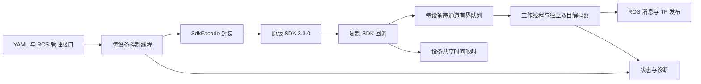

# 架构与 SDK 差异

## 模块边界

- `core.hpp/config.cpp`：配置、能力验证、队列、时间映射。
- `sdk.hpp/sdk.cpp`：完整 SDK 调用集中在 SdkFacade；生产用 LiveSdk，测试注入 MockSdk，不修改供应商代码。
- `conversion.cpp`：直接构建 PointCloud2，避免引入 PCL；消息单位、字段与 frame 转换。
- `decoder.cpp`：后端选择、参数集与参考帧恢复；FFmpeg／Jetson GStreamer 自动硬解与 CPU 回退，各相机持有独立上下文。
- `driver.cpp`：设备生命周期、管理服务、动态配置、队列调度、状态／诊断、异步文件任务。

## 生命周期与线程

每设备状态：disconnected → discovering → connecting → configuring → running；失败进入 retrying，退出进入 stopped。重试间隔1、2、4、8、16、30秒，成功后重置。指定 IP 跳过广播结果选择，直接用 IP 和可回传 host_ip 连接；自动发现只连接唯一配置匹配，避免多设备串流。

配置阶段查询能力，验证相机格式位掩码／尺寸／帧率，先 standby，再配置同步、传感器模式和滤波，订阅选中的流及内部依赖，最后恢复期望设备模式。每2秒检查命令通信和 PTP。在 normal 模式下，启动宽限10秒后，任何已启用非遥测流或世界 SLAM 的 LF 依赖10秒无数据，会触发受控重连。standby／upgrade 不因无采集数据而重连；遥测单独异常只告警，避免固件不支持遥测造成重连循环。

SDK 回调只复制包、记录必要统计、映射时间并入队，不作解码和控制调用。队列按数量和估计字节数双限，超限丢旧帧，单包过大直接丢弃。同通道最多一个工作任务，不同通道可并行，轮询避免某个流独占处理。最终发布在短锁内重验 ready、generation 和 enabled，确保配置／重连失效原子地阻止旧数据发送。

断开先停止接收并使 generation 失效、清旧队列，再调用 SDK DisconnectDevice 加入接收线程，最后释放回调上下文。工作线程尚未完成的解码结果因 generation 失效不发布。退出先停状态 timer，通知控制／工作线程，控制线程关闭 SDK，待所有线程退出后销毁服务和上下文；不在 SDK 回调线程关闭设备。

服务与 dynamic_reconfigure 共用控制队列。设置通道会完整受控重连；失败恢复上一次设备配置，恢复失败则断开并报告未就绪。滤波与模式设置执行查询、设置、读回；部分失败尝试恢复。异步文件任务立即返回任务 ID，实际 SDK 调用在设备控制线程执行，不阻塞数据处理；SDK 内部全局锁可能使另一设备的控制命令等待，驱动无法消除该供应商限制。

## 视频恢复

H264／H265 接收 Annex B 码流，用实际 NAL 判断随机接入帧，不把 SDK 的 SPS 标记直接作为恢复依据。分别缓存 SPS/PPS 或 VPS/SPS/PPS，支持参数 NAL 单独到达。SDK 帧号缺口、驱动队列丢弃或解码失败时重置参考状态，保留本连接参数并等待 IDR／HEVC 随机接入帧；设备／时钟 generation 变化清空旧参数。双目参数与参考帧完全独立。

限频仍解码所有视频包，然后抑制过快 ROS 输出，避免解码参考链因主机限频断裂。解码输出通过输入 token 关联原 header 和 generation；未完成映射有界，异步结果在无新包时仍被轮询。即使解码失败，已配置的 encoded 输出仍可发布。解码一次包可能输出0或多帧，因此 `published` 与 `decoded_frames` 意义不同。

## 已确认的 SDK 行为与封装处理

| SDK 3.3.0 行为 | 驱动处理 |
|---|---|
| SDK handle=0 会隐式选择默认设备 | 封装拒绝零句柄，控制任务执行前重新验证就绪状态，避免一台断开时管理请求误操作另一台 |
| SDK logger 回调指针默认未初始化，错误日志路径会空指针跳转 | LiveSdk 初始化时按原版 sample 调用 log_config，再允许任何发现／连接操作；不可达设备测试覆盖此路径 |
| 点云转换为 float 后仍是 mm；Y/Z 已减30000 | 驱动仅乘0.001，保留设备轴，不重复偏移 |
| 原始失效点 x=0；SLAM 补零可能经过偏移／世界变换 | 明确可识别失效点用 NaN，不声称可识别全部 SLAM 丢包补点 |
| IMU v2 assembler 按 timestamp+j×interval_ns 每样本回调 | 单样本逐一映射时间，不再次重建间隔 |
| SLAM／Odom 同步可按设备开关 | 默认关闭；world 模式开启并内部订阅LF，frame=odom |
| 四元数为 x,y,z,w；Odom covariance 仅18项 | 标准消息校验／归一化，用用户36项；自定义消息保留原始18项和原四元数 |
| StartStream 只为相机接收 acquisition mode | 拒绝非相机采集宽高、fps、format |
| 能力格式可为位掩码 | 验证所选单一位及模式组合，拒绝 unknown=255 作为有效支持 |
| H264 有专用组装；H265 走通用图像组装 | 按设备能力启用 H265，EncodedFrame 保留格式，自动优先硬件 HEVC 解码 |
| StartTelemetry 在一些失败分支仍可能返回 kOk | 同时查询订阅并观测真实到达；无数据告警 |
| 遥测无专用停止接口 | 切换启停受控重连，释放旧订阅上下文 |
| SDK telemetry JSON 解析支持的字段有限，schema/版本存在差异 | 发布 SDK 已解析的全部结构化字段；字段为0不等于已证明设备测量为0；需实机核对固件 schema |
| PTP locked 不定义设备 timestamp epoch | 默认设备时钟映射，不自动当作 UNIX ns |
| SDK 标定 bin 格式未与 ROS YAML 一一对应 | 文件交付；CameraInfo 单独采用标准 YAML |
| SDK 文件调用同步、无取消；上传无显式 timeout | ROS 异步任务状态；不提供取消承诺，不伪造上传超时能力 |
| 多项 SDK 命令在全局 mutex 内等待 | 各设备控制流程独立，但底层控制吞吐可能受全局锁限制 |

## 构建与版权交付

通过 add_subdirectory 在 Catkin build 下构建 SDK，ODIN_BUILD_SAMPLES=OFF，SDK 输出重定向到 devel/lib；安装保留完整 SO 版本链和公共头文件。驱动／节点设置相对 `$ORIGIN` RPATH，并依靠标准 Catkin setup 配置安装空间。完整本地测试版本的 runtime smoke 在移动到 `/opt/odin2` 后检查动态库、Python 消息和真实 SDK 节点状态发布；该测试脚本保留在本地，提交后的镜像只执行动态库检查。

镜像包含 SDK 与驱动对应源码包、LICENSE、第三方声明、GPL-2 文本及 build-info.txt。源码 archive 和编译脚本对应镜像构建输入；CI OCI revision 标签保存提交版本，provenance/SBOM 保存构建来源与依赖。SDK 原许可缺失不由驱动代为授权，详见 THIRD_PARTY_NOTICES.md。

硬件后端、异步结果轮询与回退机制见 [硬件解码](hardware-decoding.md)。解码结果与编码透传分别限频，以原始 SDK 包去重统计 published，防止异步输出重复计数。
